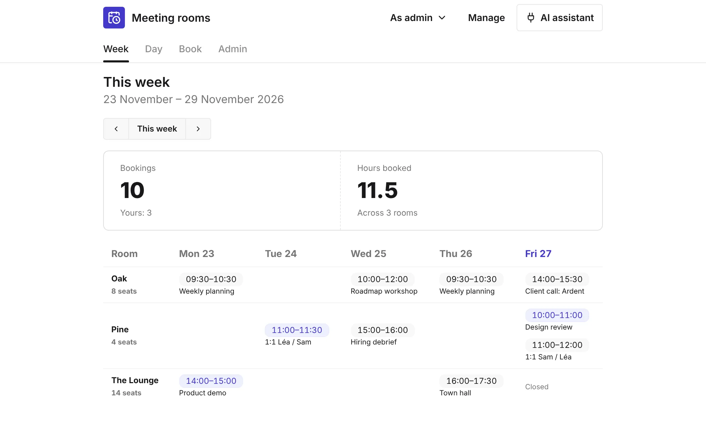

# Cliquet

Cliquet lets your AI assistant build and deploy an app for your process and its data, and runs it securely. Your team works in the app from a phone or a browser, your agents through its tools, and a change that breaks a rule is refused, whoever makes it.

**[cliquet.dev](https://cliquet.dev)** · **[Docs](https://cliquet.dev/docs/)** · **[Try the hosted beta](https://app.cliquet.dev/signup)**

<picture>
  <source media="(prefers-color-scheme: dark)" srcset="website/docs/assets/screens/app-week-dark.webp">
  
</picture>

## How it works

- **Your assistant builds the app.** Connect Claude, ChatGPT, Codex, Cursor or any MCP client to Cliquet, and say what you track and the rules it must follow. Cliquet's builder gives the assistant the tools to write the app, test it, look at its screens and publish it, with no shell.
- **An app is one short Python file:** its data, the actions that change it, the queries that read it, the screens people use, and its invariants, the rules every change must keep.
- **Every change is checked, then kept in git.** An action runs on a copy of the data, every invariant runs on the result, and the change is committed or refused with the reasons. History, undo and export come from git.
- **People and agents share the app.** People use its screens in a browser, on a phone or inside their assistant, and agents call its tools over MCP. Each has a role, and the same rules hold for both.
- **App code never runs in the server.** On the hosted service, it runs in a sandbox of its own for each owner, with no network, and the server checks everything a sandbox sends back.

## What an app looks like

A room booking app, cut down to one action, one rule and one query:

```python
import json
from datetime import date, time
from pathlib import Path

from cliquet import ActionContext, App, BaseModel, InvariantContext, QueryContext

BOOKINGS = "bookings.json"
rooms = App("rooms", files=[BOOKINGS])


class Booking(BaseModel):
    room: str
    day: date
    start: time
    end: time
    by: str


def load() -> list[Booking]:
    path = Path(BOOKINGS)
    return [Booking(**b) for b in json.loads(path.read_text())] if path.exists() else []


@rooms.action
def book(ctx: ActionContext, room: str, day: date, start: time, end: time) -> None:
    """Book a room for a meeting."""
    booking = Booking(room=room, day=day, start=start, end=end, by=ctx.caller.id)
    rows = [b.model_dump(mode="json") for b in [*load(), booking]]
    Path(BOOKINGS).write_text(json.dumps(rows))


@rooms.invariant("A room is never booked twice at the same time")
def no_double_booking(ctx: InvariantContext) -> list[str]:
    bookings = load()
    return [
        f"{a.room} is already booked on {a.day} from {a.start} to {a.end}"
        for i, a in enumerate(bookings)
        for b in bookings[i + 1 :]
        if a.room == b.room and a.day == b.day and a.start < b.end and b.start < a.end
    ]


@rooms.query
def bookings_on(ctx: QueryContext, day: date) -> list[Booking]:
    """The bookings of one day."""
    return [b for b in load() if b.day == day]
```

An agent calls `book` over MCP, or a person from the app's screen once it has one. A booking that overlaps another is refused with the invariant's words, whoever made it, and nothing is written. The [examples](examples/) are whole apps, with their screens and tests: a meeting rooms plan, an environment register and a household ledger.

## Get started

**On the hosted service:** sign up at [app.cliquet.dev](https://app.cliquet.dev/signup), free within a monthly limit on sandbox time, then connect your assistant, as the [quickstart](https://cliquet.dev/docs/) shows.

**On your own machine,** with Docker Engine 26 or later and Compose:

```bash
cd docker
cp .env.example .env    # on Linux, also set DOCKER_GID, as its comments say
docker compose build
docker compose up -d
```

Open `http://127.0.0.1:8800/`, signed in as `sam`, and connect your assistant to your own endpoint. In Claude Code:

```bash
claude mcp add --transport http cliquet http://127.0.0.1:8800/me/mcp \
  --header "Authorization: Bearer dev"
```

Under the development login, any token signs in as `sam`, who may build. A server on a public address takes more setup, such as HTTPS and a sign-in provider: see [Self hosting](https://cliquet.dev/docs/guides/self-hosting/).

## Developing Cliquet

You need Python 3.14 or later and [uv](https://docs.astral.sh/uv/):

```bash
uv sync
uv run pytest
CLIQUET_DEV_LOGIN=sam uv run cliquet-server run
```

[AGENTS.md](AGENTS.md) has the rest: the commands, the conventions and the definition of done. [ARCHITECTURE.md](ARCHITECTURE.md) describes the main architectural decisions, each with its reason.

## Contributing and security

Issues are welcome. Pull requests are closed for now: [CONTRIBUTING.md](CONTRIBUTING.md) says why. Report a vulnerability privately, never in an issue, as [SECURITY.md](SECURITY.md) says.

## Licences

- **The server**, in `packages/server/`, is under the [GNU Affero General Public License v3.0 only](packages/server/LICENSE).
- **Everything an app imports or copies** is under the [Apache License 2.0](LICENSE), so apps carry no conditions: the SDK in `packages/sdk/`, the examples in `examples/`, and the builder's guides in `packages/server/src/cliquet_server/builder/guides/`, though they sit inside the server's folder.
- **The rest of the repository**, such as the scripts, the website and the docs, is under the Apache License 2.0 too.
- **Vendored files** keep their own licences, kept next to them: daisyUI and Chart.js (MIT), htmx (0BSD) and Lucide (ISC).

The name Cliquet, cliquet.dev and the logo are not licensed.
